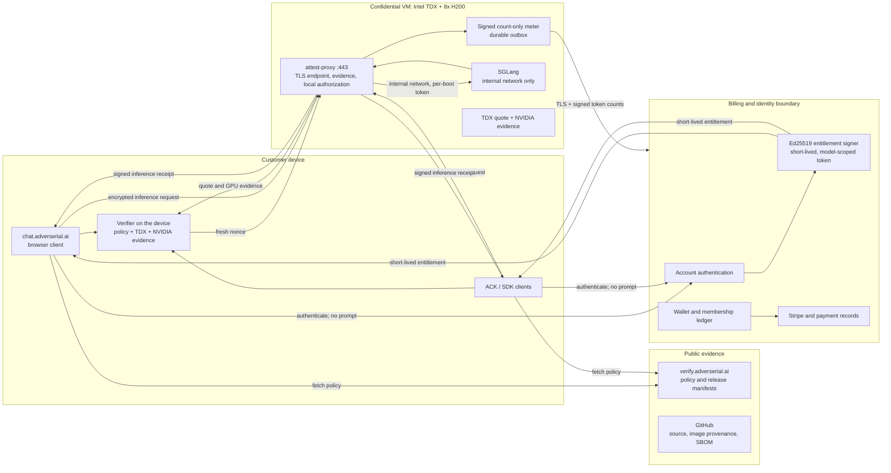

# Confidential inference architecture

This document describes the confidential-inference path as deployed. The exact
composition is in [`deployed/`](deployed/README.md). Deployment status: rolled
out 2026-11-24; policy update pending first live attestation.

A description is not proof. A client must reject an endpoint until it has
received fresh hardware evidence, validated it independently, and found it to
match the published policy.

## Confidential path

### Where TLS ends

`api.adverserial.ai` is a CNAME to a Phala gateway
(`gateway.dstack-pha1-usc1.phala.network`) that forwards TLS bytes without
terminating them. The TLS private key is generated in `attest-proxy` inside
the VM and HTTP is terminated there. Heroku, Cloudflare, the public evidence
site and billing do not receive the decrypted inference request.

The chat application at `chat.adverserial.ai` runs outside the VM. Its server
handles sign-in and entitlement requests; it does not receive prompts or
completions. The browser encrypts each request to the key bound into the
attestation evidence and sends it directly to `api.adverserial.ai`.

### Inside the VM

- `attest-proxy` is the only service with a published port.
- The model server (SGLang, model `adverserial/cyberseek`) is attached only to
  a Docker network declared `internal: true`. It has no published port and no
  route out of the VM. An earlier design had it share the proxy's network
  namespace and listen on loopback; that is no longer the case.
- The proxy authenticates to the model server with a random token that a
  one-shot service generates inside the VM at each boot.
- Before the proxy or the model server start, every model file is hashed in a
  container without network access and compared with a manifest embedded in
  the composition.

### Keys

Since `attest-proxy` `v0.1.0-rc.31`, the receipt signing key (P-256), the
meter signing key (Ed25519), the HPKE/EHBP key (X25519, new at each proxy
start) and the TLS key (certified through ACME DNS-01 on Cloudflare) are all
generated inside the VM. In confidential mode the proxy refuses a seed or
identity supplied as configuration.

Releases up to `v0.1.0-rc.30` were different: the receipt and meter keys were
derived from operator-generated seeds, and the EHBP identity and the
proxy-to-model token were operator-generated too, all passed in as sealed
configuration. The operator therefore held values with which receipts or
usage records could have been signed, or request bodies decrypted, outside
the VM.

The operator still supplies four sealed credentials for outside services
(Hugging Face, Cloudflare DNS, NVIDIA attestation, and the billing meter
capability). None is a key of the service itself. Because the operator
controls DNS for the hostname, a publicly trusted certificate alone does not
prove that a connection ends in the VM; clients compare the TLS key with the
one in fresh evidence.

### What billing receives

Billing receives identity and payment data as necessary to operate an account.
For inference settlement it receives only a signed record containing an
entitlement ID, request ID, canonical model ID, input/cached-input/output
counts, timestamp, and meter signature. It does not receive prompts,
completions, attachments, chat history, raw API keys, or model weights.

### Authorization and settlement

1. Billing authenticates the account and reserves the requested maximum
   tokens against membership allowance or wallet funds.
2. Billing returns a short-lived Ed25519-signed entitlement scoped to one
   canonical model, one confidential API audience, a reservation ID, and an
   expiry.
3. The proxy verifies the token locally with billing's public key. It never
   calls billing in the prompt path.
4. After generation, the proxy writes one signed count-only event to a durable
   outbox and sends it directly over outbound TLS to
   `https://billing.adverserial.ai` (`METER_DELIVERY_MODE: direct-signed`).
   Billing requires the dedicated meter capability **and** verifies the
   proxy's Ed25519 signature before idempotent settlement.
5. If the meter cannot deliver an event, its durable outbox retries it. The
   client response is not silently converted into an unbilled request.

The separate mTLS service in
[confidential-meter-ingress](https://github.com/AdverserialAI/confidential-meter-ingress)
is not in this path. The proxy can be configured to use it; production is not.

## Earlier transition path

Until the hostname cutover on 2026-10-07, `api.adverserial.ai` and
`chat.adverserial.ai` pointed at conventional services that terminated TLS in
front of the GPU host and could see request content. Those were never
presented as confidential inference. The primary hostnames now point at the
path described above.

## What a client has to check

| Control | Evidence |
| --- | --- |
| Hardware isolation | Fresh nonce-bound Intel TDX quote and NVIDIA evidence, verified on the client. |
| Runtime identity | The published policy pins the proxy release, runtime image, configuration (`compose_hash` and the compose self-digest), model artifact digest, and receipt key. The policy is distributed over HTTPS and is not signed. |
| Transport binding | The quote binds the TLS SPKI and the EHBP public key to a fresh nonce; the policy pins the TLS SPKI fingerprint the client must observe. |
| Chat provenance | Tagged releases of `confidential-open-webui` carry GitHub build provenance. The hosted chat is currently built from the `main` branch and reports a development build manifest, so a served bundle cannot yet be matched to a tagged release. |
| Entitlement authority | Billing's public Ed25519 JWK set, short expiries, audience/model binding, and replay controls. |
| Meter integrity | Outbound TLS to a fixed billing origin, dedicated meter capability, signed count-only JWS, durable outbox, idempotent reservation settlement. |

## Trust boundaries

- A policy or proxy receipt alone is not hardware verification.
- A browser page cannot establish trust in its own first JavaScript bundle;
  a locally installed client (ACK or the SDK) is the stronger bootstrap.
- Billing is outside the inference confidentiality boundary. It never
  receives inference content.
- An attested VM is not sufficient by itself. The client must verify fresh
  evidence and reject a mismatch before it sends a prompt.
- Images are pinned by digest and built with provenance and SBOMs. Rebuilding
  them from source to the same digest has not been demonstrated, so no
  reproducible-build claim is made.
